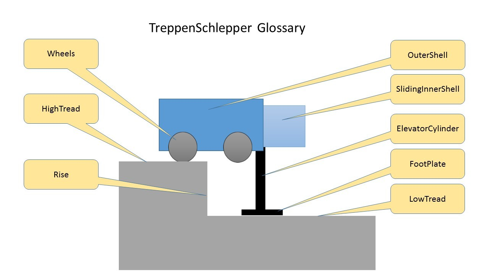

# TreppenSchlepper
TreppenSchlepper will build a fully autonomous device to carry heavy cargo (and eventually persons) up and down stairs. The device climbs stairs step-by-step using a telescoping lift-and-slide mechanism. Reference blog: https://treppenschlepper.blogspot.com

